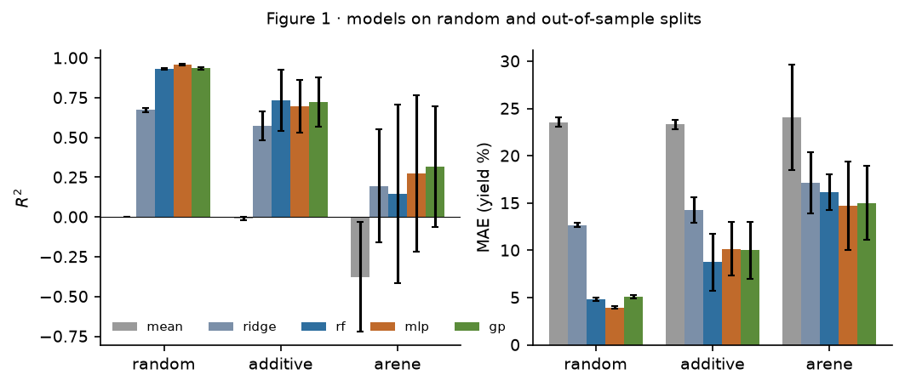
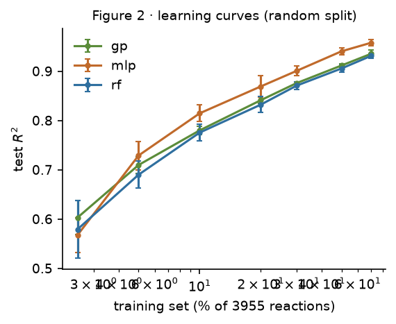
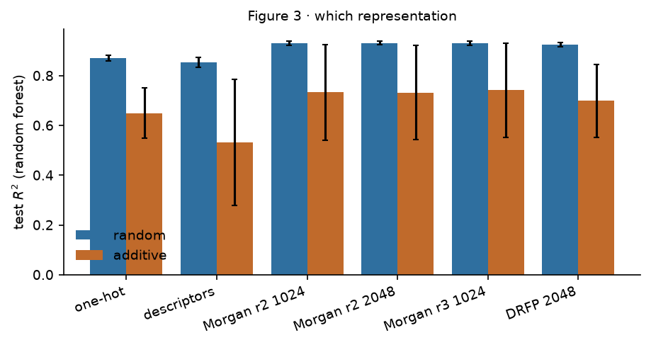
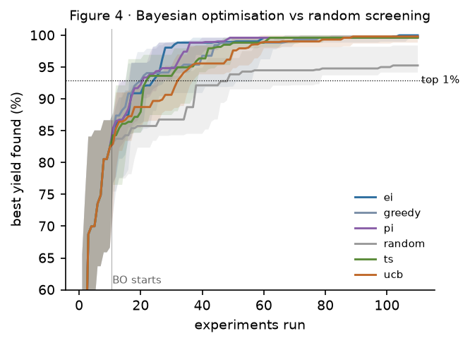
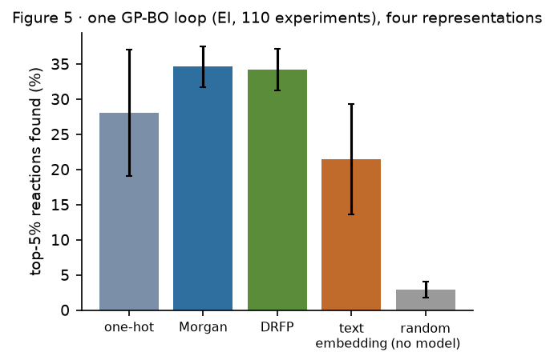

# rxnbo

**With a limited budget of experiments, can machine learning and Bayesian optimisation find high-yield reaction
conditions faster than random screening?**

One data set, one question, every step written out: featurising reactions, supervised yield models, Gaussian
processes with a Tanimoto kernel, batch Bayesian optimisation, and (Tables 2–3) LLM extraction and a small tool-using
agent.

## Data

Ahneman *et al.*, *Science* 2018, 360, 186: 3,955 Pd-catalysed Buchwald–Hartwig couplings of p-toluidine with
15 aryl halides × 4 ligands (XPhos, tBuXPhos, tBuBrettPhos, AdBrettPhos) × 3 bases (BTMG, P2Et, MTBD) ×
22 isoxazole additives, from high-throughput experimentation. The file is the one distributed with
[rxn4chemistry/rxn_yields](https://github.com/rxn4chemistry/rxn_yields) (`data/raw/`).

The product is not in the file; it is made with one reaction SMARTS (`filters.py`):
`[c:1][Cl,Br,I]>>[c:1][NH]c1ccc(C)cc1`.

Three splits (`data.py`), from easy to hard:

| split | held out | what it tests |
| --- | --- | --- |
| random | 30 % of reactions (5 seeds) | interpolation |
| additive | Test1–4 of the paper: 5 additives never seen | a new additive |
| arene | one arene, its Cl, Br and I forms together (5 folds) | a new substrate |

## Results

All numbers are means over seeds or folds; every figure is drawn from a CSV in `results/`.

**Figure 1 · models** (Morgan fingerprints, radius 2, 1024 bits per component)

| model | random R² | additive R² | arene R² |
| --- | --- | --- | --- |
| mean (baseline) | 0.00 | −0.01 | −0.38 |
| Ridge | 0.67 | 0.57 | 0.20 |
| random forest | 0.93 | 0.73 | 0.15 |
| MLP (PyTorch) | **0.96** | 0.70 | 0.27 |
| GP, Tanimoto kernel | 0.94 | 0.72 | **0.32** |

- On a random split every non-linear model is near the literature (RF ≈ 0.92, Yield-BERT ≈ 0.95).
- A new additive costs about 0.2 in R²; a new arene costs most of it. A model of this data set mostly knows
  *which of the 3,955 combinations it is*, not chemistry that transfers to a substrate it has not seen.
- The GP's 95 % predictive intervals cover 94.9 % of test reactions on the random split: its uncertainty is
  calibrated, which is what Bayesian optimisation relies on.



**Figure 2 · learning curves.** With 2.5 % of the data (99 reactions) the GP and the RF already reach R² ≈ 0.6.


**Figure 3 · representation** (random forest). Morgan fingerprints (0.93 / 0.73) ≥ DRFP (0.93 / 0.70) > one-hot
(0.87 / 0.65) > twelve RDKit descriptors per component (0.85 / 0.53); radius and length matter little.


**Figure 4 and Table 1 · Bayesian optimisation.** 10 random reactions, then 20 rounds of 5 chosen by a GP
(Tanimoto kernel on Morgan bits); 20 seeds; the same random start for every strategy.

| strategy | experiments to a top-1 % reaction (median) | top-5 % reactions found in 110 | best yield found (mean) |
| --- | --- | --- | --- |
| random | 47.5 (4 of 20 runs never) | 3 % | 95.3 % |
| greedy (mean) | 20 | 32 % | 99.6 % |
| EI | 24.5 | 35 % | 99.8 % |
| PI | 21 | 36 % | 99.8 % |
| UCB (β = 4) | 32.5 | 11 % | 99.1 % |
| Thompson | 22 | 23 % | 99.7 % |

Every model-guided strategy finds a top-1 % reaction in about half the experiments random screening needs, and
finds ten times as many of the top 5 %. UCB with a large β explores more and exploits less, which shows here.



**Figure 5 · representation inside BO** (EI, 20 seeds): Morgan 35 % ≈ DRFP 34 % > one-hot 28 % > text embedding
of the reaction written as a sentence (`bge-small`, RBF kernel) 21 % ≫ random 3 % of the top-5 % found. A small
general text model does not know chemistry well enough to help here; the idea needs a chemistry-aware LLM
(as in BoChemian / GOLLuM).



**Table 2 · LLM extraction** (`llm_extract.py`) and **Table 3 · tool-using agent** (`agent.py`) are implemented
and tested offline (a fake client plays the model); they need an API key to run:
- Table 2: 100 AstraZeneca lab-notebook procedures from the Open Reaction Database
  (`ord_dataset-00005539…`), whose structured fields — entered by the chemists — are the answer key. Compounds
  are scored by structure (InChIKey connectivity), not spelling.
- Table 3: 30 questions about molecules with RDKit-computed answers, each asked with and without three RDKit tools.

## Two things worth knowing about the code

- **The GP fits in 5 s instead of 116 s.** The Tanimoto kernel has no length scale, so the kernel matrix `T` is
  the same at every optimiser step. One eigendecomposition `T = Q diag(λ) Qᵀ` turns the marginal likelihood into
  sums over `λ` (O(n) per step instead of a Cholesky). Same hyperparameters, same R² to six digits.
- **Thompson sampling over all 3,955 candidates is exact** (`GP.sample_pool`, Matheron's rule): a prior draw over
  the pool from one Cholesky of `T`, moved to agree with the data. Tested against the posterior mean and variance.
- A bug found on the way: the MLP standardised each input column by its training spread; a fingerprint bit that no
  training reaction sets has spread 0, so the bit of an unseen additive became 10⁶ at test time (R² = −3 × 10⁶ on
  the additive split). Such columns now keep scale 1 (`tests/test_mlp.py`).

## Run it

```bash
uv venv && uv pip install -e ".[dev,embed]"
rxnbo prepare        # data/processed/ from the Excel file
rxnbo fig1           # one figure (fig1 … fig5), or: rxnbo all
pytest               # 44 tests
ANTHROPIC_API_KEY=… rxnbo extract    # Table 2
ANTHROPIC_API_KEY=… rxnbo agent      # Table 3
```

`rxnbo fig1` on a laptop (8 cores): about 20 minutes; `fig4` 5 minutes.

## Layout

```
src/rxnbo/
  data.py         loading, the three splits
  filters.py      reaction SMARTS (the product), substructure, PAINS, scaffolds
  featurize.py    standardisation, one-hot, Morgan, descriptors, DRFP
  embed.py        reactions as sentences → text embeddings
  models/         baselines.py · mlp.py (training loop written out) · gp.py (exact GP, two kernels)
  bo.py           acquisition functions, batch BO, metrics
  llm_extract.py  structured extraction + scoring
  agent.py        the agent loop, its RDKit tools, the test
  evaluate.py     metrics and figures
  experiments.py  Figures 1–5, Table 1
tests/            44 tests, no network
```

## Limits

- One data set, made by a robot on one plate format: its yields vary far more smoothly over 3,955 combinations
  than a real substrate scope does.
- BO here chooses among reactions that were all run; a real campaign would have to run them, with noise and
  failed plates.
- The arene split has only five folds of very different difficulty; its error bars are wide.
